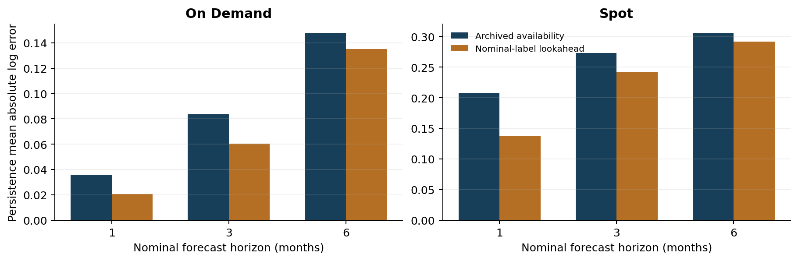

# GPU Rental Backtest Audit

**Information timing, service identity, and persistence in public GPU rental prices.**

**[Current preprint (PDF, 13 pages)](output/pdf/gpu_rental_forecasting_preprint.pdf)** · [Reproducibility package](output/gpu_rental_reproducibility.zip) · [LaTeX source](output/gpu_rental_arxiv_source.zip) · [Cite this preprint](CITATION.cff)

[](https://github.com/esadomer/gpu-rental-backtest-audit/actions/workflows/tests.yml)

**Author:** H. Esad Kay  
**Status:** research preprint, October 29, 2026; not submitted to arXiv.

The current PDF, manuscript source, reproducibility package and analysis outputs are synchronized. This repository includes the supplemental block-bootstrap, provider/year, origin-deletion, changed-price, attrition and frequency-benchmark analyses described in the paper.

[Methods and protocol](reports/analysis_plan.md) · [Primary results](results/forecast_summary.csv) · [Supplemental results](results/v3/) · [Origin-deletion results](results/origin_sensitivity/) · [Prior-work comparison](reports/literature_overlap.md)

## Central finding

A backtest can appear substantially better because its inputs contain information published after the forecast origin. In a controlled month-start comparison, granting later catalog records at their nominal month-start lowers one-month on-demand persistence **mean absolute log error by 42.0%**, on identical matched forecast cases:

| Information available to the forecast | Mean absolute log error |
|---|---:|
| Archived publication timing | 0.0353 |
| Nominal-month labels granting later information | 0.0205 |

This is an apparent improvement in the error metric caused by an inadmissible information set. It is not a new model advantage, a price discount, or a trading return. The primary admissible experiment uses eighth-day origins; this separate diagnostic uses month-start origins.



## Robustness and selection diagnostics

The [separate supplemental plan](reports/v3_analysis_plan.md) and [origin-deletion plan](reports/origin_sensitivity_plan.md) were each fixed after earlier results were known and before calculating their additional diagnostics. These are exploratory checks on the same data, not preregistered or independent confirmation.

- **Timing stability:** the one-month on-demand 42.0% apparent error reduction has an exploratory 95% paired calendar-block interval of **23.9–63.6%** (three-month blocks, 18 scored origins). Provider-omission estimates range from **37.5–44.8%**; fixed 2025/2026 origin slices give **43.5% / 39.1%**. Individual-provider results are heterogeneous, and six-month-block intervals are suppressed for insufficient time support. [Block diagnostics](results/v3/timing_bootstrap.csv). Removing one complete origin at a time gives **28.9–51.1%**, with all 18 one-month on-demand deletions remaining positive. July 2025 contributes **45.5%** of the full signed loss difference, so the preserved sign does not rule out concentration across several months. [All 94 origin deletions](results/origin_sensitivity/leave_one_origin_out.csv).
- **Changed-price outcomes:** there are **423** changed one-month on-demand cases across nine origins. Ridge is slightly better than persistence within that ex-post subset (MALE 0.2209 vs 0.2227), but creates errors on unchanged quotes and loses overall. Original evaluation weights are retained so subgroup contributions exactly reconcile to total loss. [Conditional results](results/v3/conditional_losses.csv).
- **Structured missingness:** 901 of 1,016 missing one-month on-demand targets come from two late archives; 115 have absent service keys. Spot has 319 late-archive and 325 absent-key cases. Their lagged characteristics differ. These diagnostics do not recover missing outcomes or establish the direction of selection bias. [Attrition](results/v3/attrition_summary.csv) · [Characteristics](results/v3/attrition_features.csv).
- **One additional fixed benchmark:** historical change frequency shrinks the original damped trend toward persistence. It improves on damped trend but remains **7.0–30.1% worse than persistence** across the six primary cells. It is a disclosed post-result heuristic, not a tuned forecasting breakthrough. [Benchmark comparisons](results/v3/benchmark_summary.csv).

The original five-model experiment and its numerical outputs are unchanged.

## What the study does

The project independently parses **37 original public catalogs** covering August 2023 through September 2026. After exclusions, it contains **20,377 service-month records** for A100, H100 and H200 services from six economic providers. It evaluates persistence, drift, local trend, damped trend and pooled ridge at one-, three- and six-month horizons.

The primary evaluation has **22,868 eligible service-origin-horizon cases**, including **18,226 observed targets**. Missing targets stay missing. Inputs and training outcomes must be available by the forecast origin. The model menu and evaluation rules were specified before examining forecast performance; subsequent factual corrections are disclosed.

Persistence has the lowest provider-balanced error in all six primary market/horizon comparisons. That result needs context:

- **90.7%** of the provider-balanced one-month on-demand targets are unchanged. This is a weighted rate, not a raw share of all rows.
- Primary H200 six-month evidence consists of **four on-demand cases and no spot cases**. These are not independent market events.
- Strict optional-field service matching leaves **no scored six-month evaluation**.
- Archive timestamps are availability proxies. Catalog states can be stale, and quotes do not prove execution access or capacity.

The contribution is a controlled forecast-evaluation audit of information timing and observable service continuity, not a new forecasting algorithm. It builds on [Rahil Mittal's public reconstruction](https://github.com/rahilmittal1/gpu-price-history), which already documents timing, identity, staleness and price-rigidity issues. The exact rolling future-quote experiment and matched forecast-error diagnostic were not found in the inspected public implementation. The full companion manuscript was not located, so novelty relative to that manuscript remains unresolved. See the [evidence-based overlap audit](reports/literature_overlap.md).

## Reproduce from public sources

Clone the repository or extract the reproducibility ZIP into an empty directory. Python 3.12 and the versions in `requirements.txt` are used. No credentials, paid feed or vendor request is required. Synthetic data is restricted to unit-test fixtures and never enters the empirical output.

```bash
git clone https://github.com/esadomer/gpu-rental-backtest-audit.git
cd gpu-rental-backtest-audit
python -m venv .venv
```

Activate the environment with `source .venv/bin/activate` on macOS/Linux or `.\.venv\Scripts\Activate.ps1` in PowerShell, then run:

```bash
python -m pip install -r requirements.txt
python scripts/fetch_sources.py --only rental_panel rental_readme rental_license
python scripts/fetch_catalogs.py
python -m unittest discover -s tests -v
python scripts/run_study.py
python scripts/verify_results.py
python scripts/make_figures.py
python scripts/robustness_diagnostics.py
python scripts/verify_v3.py
python scripts/origin_sensitivity.py
python scripts/verify_origin_sensitivity.py
python scripts/make_v3_figures.py
```

The source locator is pinned to Mittal revision `ee8820dd90d7715d8bb57cee03fb0882706d76c5`. Forecast prices come from original gpuhunt archives, not the predecessor's cleaned price index. Missing registered inputs are downloaded only if their saved hashes match. Existing corrupt caches and changed vintages fail explicitly. The historical source manifests are preserved; analysis runs offline after retrieval.

A clean-directory run downloaded all registered rental inputs, regenerated the study and reproduced **all 16 CSV outputs byte for byte**. **59 tests pass**, including 25 supplemental boundary tests. See the [verification record](reports/verification.md). Continuous integration runs the behavioral tests without downloading the research dataset. The final offline clean-directory check reproduced **all 26 numerical CSVs byte for byte**; the original network-retrieval check and subsequent offline checks are distinguished in the verification record.

### Build the manuscript

With Tectonic 0.17.0 or a compatible LaTeX installation:

```bash
python scripts/make_figures.py
python scripts/make_v3_figures.py
tectonic paper/main.tex --outdir paper
```

The entry point is [paper/main.tex](paper/main.tex); figures and table inputs are local. The [compiled PDF](output/pdf/gpu_rental_forecasting_preprint.pdf), [portable source ZIP](output/gpu_rental_arxiv_source.zip), and [reproducibility ZIP](output/gpu_rental_reproducibility.zip) are supplied. Local compilation does not certify arXiv server-side compilation.

## Navigate the evidence

| Location | Contents |
|---|---|
| `config/` | Original frozen protocol, provider-alias correction, separate post-V2 supplement and authenticated base-run reference |
| `data/catalog_manifest.json` | Exact archive URLs, publication proxies, retrieval times and SHA-256 hashes |
| `data/research/` | Committed coverage/member fingerprints; raw extraction is generated locally |
| `scripts/` | Retrieval, parsing, forecasting, result verification and scientific figures |
| `tests/` | Synthetic behavioral fixtures only |
| `results/v3/` | Aggregate timing, conditional-loss, attrition and benchmark results |
| `results/origin_sensitivity/` | All 94 complete-origin deletions and six-cell summaries |
| `results/` | Aggregate errors, paired origin losses, attrition and provider sensitivities |
| `paper/` | English single-author LaTeX manuscript, tables and figures |
| `reports/literature_overlap.md` | Specific overlap with prior work and unresolved novelty limits |

After reproduction, `results/forecast_cases.csv` contains every eligible primary/sensitivity case, including missing targets. `data/research/catalog_panel.csv` traces extracted observations to archive, member, CSV line and raw source record. These row-level outputs and original third-party archives are intentionally not redistributed in Git.

Losses average within a provider-origin, then equally across represented providers, then across scored origins. On-demand and spot remain separate headline populations. Unchanged/repeated-member rates use the same nested weights; `_raw_rows` columns preserve raw shares. Missing-target rates are raw fractions of eligible cases. Overlapping horizons and shared provider decisions mean row counts are not independent sample sizes.

## Scope, attribution and availability

The original purchase-price hypothesis was stopped after the [physical-data audit](reports/data_audit.md) could not establish comparable historical new-hardware condition. There is no synthetic physical backtest. The initial audit uses live tracker captures that may not be recoverable later; the rental reproduction commands above do not depend on those pages.

Credit belongs to Rahil Mittal for the source reconstruction and prior measurement work, dstack's gpuhunt for the original catalog infrastructure, and the underlying providers for their quotes. [Data provenance and distribution boundaries](reports/data_provenance.md) distinguish public access from redistribution rights. No blanket license over third-party quote data is claimed. No project-wide reuse license has been selected; public accessibility should not be interpreted as a grant of additional rights.

The current research preprint and its reproducibility materials are available through the links above. It does not establish executable returns, historical capacity, counterparty quality, hardware depreciation or guaranteed publication acceptance. [Submission status and remaining author decisions](reports/submission_notes.md).
